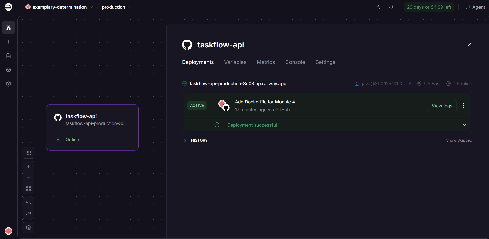
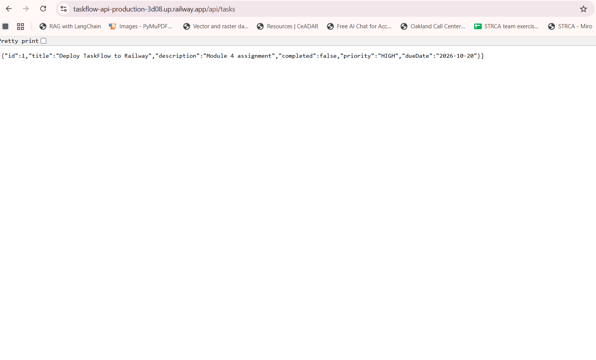

# TaskFlow API

A simple task management REST API built with Spring Boot, containerized with Docker and deployed to Railway (Module 4 - End of Module Assignment).

## Assignment submission

### Live application URL

```
https://taskflow-api-production-3d08.up.railway.app/api/tasks
```

### Screenshot: Railway dashboard

Active deployment "Add Dockerfile for Module 4", built from the Dockerfile.



### Screenshot: Live application

The live Railway URL returning task data in the browser.



### Errors and failures

```
Completed: Task 1, Task 2, Task 3, Task 4

Issues I ran into and fixed:
- Railway showed "No repositories found" when selecting the repo. Fixed by
  granting the Railway GitHub App access to the repository.
- My Dockerfile was on a starter branch (module4-assignment) whose Git history was
  unrelated to main, so GitHub said "There isn't anything to compare" and would not
  create a pull request. Fixed by creating a branch from main, copying the Dockerfile
  into it and pushing it to main (no force push; the old main was also backed up).
- The first Railway deployment did not use my Dockerfile. It auto-detected Java, which
  I noticed because the startup log showed /app/target/... instead of /app/app.jar.
  After the Dockerfile was on main, the build logs showed the Docker steps and the
  startup log showed /app/app.jar.

Note: tasks are stored in memory, so they are lost whenever the app restarts or redeploys.
```

### Stretch goal (optional)

```
Stretch goal: None
```

## Getting started

### Prerequisites

- Java 21
- Maven (or use the included Maven Wrapper)
- Docker (to run the container)

### Running the application

```bash
./mvnw spring-boot:run
```

The application starts on `http://localhost:8080`.

### Running with Docker

```bash
docker build -t taskflow:latest .
docker run -p 8080:8080 taskflow:latest
```

### API routes

| Method | Path              | Description             |
|--------|-------------------|-------------------------|
| GET    | `/api/tasks`      | Get all tasks           |
| GET    | `/api/tasks/{id}` | Get a single task by ID |
| POST   | `/api/tasks`      | Create a new task       |